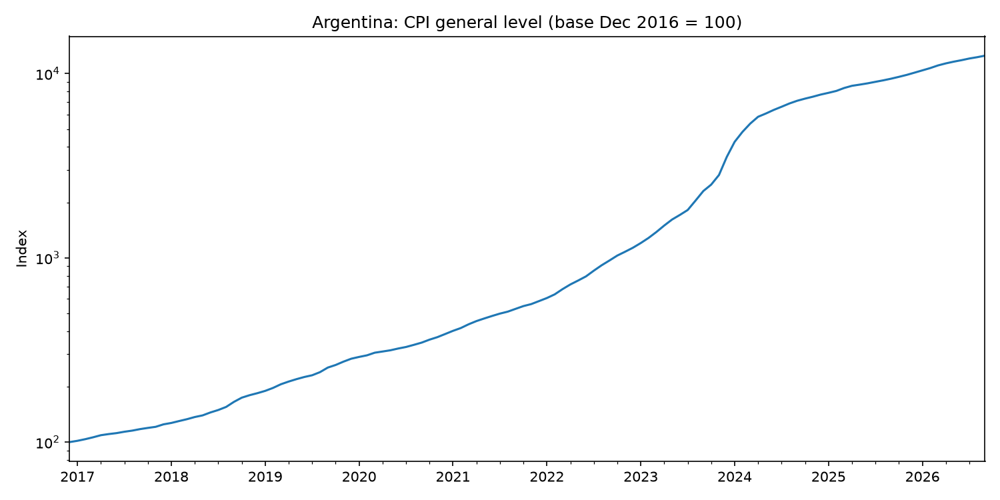
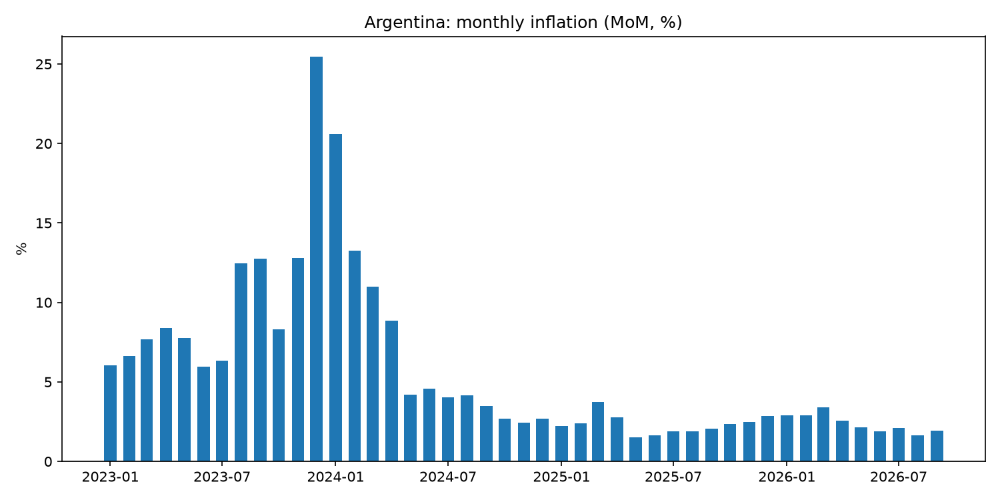
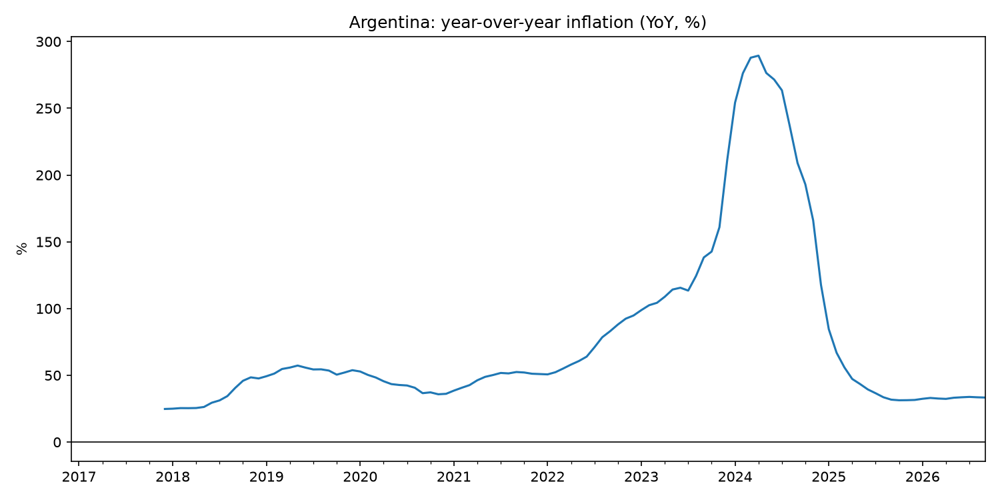

# Argentina Inflation (CPI) Analysis, 2016-2026

Cleaning and exploratory analysis of Argentina's monthly consumer price
index (CPI) from INDEC, with month-over-month and year-over-year inflation
calculated from the index level.

## Key findings

- Monthly inflation peaked at **25.47% in December 2023**.
- Year-over-year inflation peaked at **289.4% in April 2024**.
- By September 2026, YoY inflation had stabilized at around 33%.

## Charts





## Data

- **Series:** National CPI, general level, base December 2016 = 100
- **Source:** INDEC, via the datos.gob.ar catalog
- **Coverage:** December 2016 to September 2026 (118 monthly observations)
- **Downloaded:** 2026-10-30
- A cleaned copy is in `data/cpi_clean.csv`

## What the notebook does

1. Loads the data directly from the datos.gob.ar catalog
2. Cleans it (renames columns, converts dates, sets a date index)
3. Calculates MoM and YoY inflation from the index
4. Plots the CPI level, monthly inflation, and annual inflation

## How to run it

```bash
pip install pandas matplotlib jupyter
jupyter notebook argentina_cpi.ipynb
```

## Limitations

- Describes inflation; does not forecast it or explain its causes.


**Tools:** Python, pandas, matplotlib